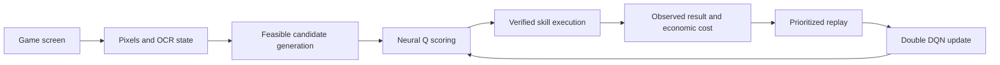

# 알고리즘 상세 및 분석 / Algorithm details and analysis

이 문서는 v0.26 소스의 실제 구현을 설명합니다. 논문의 성능을 이 프로젝트의 성능으로 인용하지 않습니다.

This document describes the implementation in v0.26. Performance reported in the cited papers is not presented as performance achieved by this project.

## 1. 관측과 행동 표현 / Observation and action representation



`live_lords/deep_rl.py`의 입력은 다음과 같습니다.

| 입력 / Input | 차원 / Dimensions | 의미 / Meaning |
| --- | ---: | --- |
| 축소 RGB / Resized RGB | 576 | 16 × 12 × 3, normalized pixels |
| 이전 관측과 차이 / Previous-observation difference | 576 | Current minus previous pixel values |
| 수치 상태 / Numeric state | 24 | VP, gold, bonuses, troops, threats, deadlines, pending work, reserves, levels, distances, elapsed time |
| 수치 유효 여부 / Validity mask | 24 | Whether each numeric value was actually available |
| 행동 표현 / Action representation | 64 | 48 hashed semantic slots, 8 numeric candidate features, 8 validity flags |
| **총 입력 / Total input** | **1,264** | 1,200 observation + 64 candidate action |

신경망은 `1264 → 64(tanh) → 32(tanh) → 1(linear)` 구조입니다. 총 학습 파라미터는 83,073개입니다. 출력은 한 후보의 Q값이므로 64차원 행동 표현이 64가지 고정 행동을 의미하지 않습니다. 현재 가능한 후보마다 같은 신경망을 호출합니다.

The network is a state-action scorer, not a fixed action-index classifier. It outputs one Q-value per supplied candidate. The 64-dimensional action encoding does not mean the system has exactly 64 actions. All trainable layers receive gradients, including weights connected to pixels. There is no pretrained CNN or large vision-language model.

16×12 화면은 전체적인 장면 변화만 표현하기에 매우 작습니다. 숫자·도시명·세부 상태는 OCR과 기존 검증기에 크게 의존합니다. 해싱된 행동 표현에는 충돌이 생길 수 있으며, 신경망이 읽지 못한 게임 정보를 복원해 준다고 가정할 수 없습니다.

The coarse image representation and hashed action encoding keep inference inexpensive, but lose detail and can collide. OCR and hand-written extractors remain essential. Missing values are marked explicitly rather than interpreted as observed zero.

## 2. Double DQN

현재 상태를 `o`, 행동 후보를 `a`, 실행 가능한 다음 후보 집합을 `A(o')`, 온라인 파라미터를 `θ`, 타깃 파라미터를 `θ−`라고 하면:

```text
a* = argmax_{a in A(o')} Q_online(o', a)
y  = r + discount × Q_target(o', a*)        # nonterminal
y  = r                                     # terminal
TD error = y − Q_online(o, a)
```

같은 신경망의 최댓값을 선택과 평가에 모두 사용하면 과대평가가 발생할 수 있습니다. 이 구현은 온라인 신경망이 다음 행동을 고르고 별도 타깃 신경망이 그 행동을 평가합니다. 위험한 공격을 무조건 피하거나 최적 전략을 보장하는 것은 아닙니다.

Online selection and target evaluation are separated to mitigate maximization bias. Targets use only the successor candidates that were actually observed and permitted, not hypothetical actions on a loading screen. The target weights synchronize every 100 gradient updates. This improves the learning mechanism; it does not guarantee safe or optimal combat decisions.

Source: [Deep Reinforcement Learning with Double Q-learning](https://arxiv.org/abs/1509.06461).

## 3. 계층형 기술과 지연 보상 / Hierarchical skills and delayed credit

전체 화면의 모든 픽셀 좌표를 자유롭게 선택하지 않습니다. 사람이 작성한 기술이 조작을 담당하고, 정책은 전략 검토, 기점, 목표, 병력 여유, 집결·방어 경로 등의 후보를 평가합니다. 각 선택은 관측과 후보 집합을 기록하고 실제 전투 결과에 연결됩니다.

The policy selects among predefined skills and parameters. It does not learn a new button location or invent a new menu interaction. A verified combat option may include multiple decisions. Intermediate decisions receive zero immediate reward; the final decision receives the verified outcome reward, and bootstrapped learning propagates value backward through the recorded sequence.

시간 할인은 `0.97 ** (elapsed_seconds / 60)`입니다. 이는 동작마다 시간이 다른 게임의 옵션 단위 학습에 맞춘 구현입니다. 화면을 한 번 읽었다고 그 이미지 전체가 정답 라벨이 되는 지도학습과는 다릅니다.

Time-dependent discounting reflects unequal action durations. The hierarchy is an engineered skill hierarchy; it is not a separately learned option-discovery algorithm. A completed battle is treated as a terminal option, while later verified ownership loss can correct its outcome.

## 4. 경험 재학습 / Prioritized experience replay

```text
priority_i = abs(TD_error_i) + 0.001
P(i) = priority_i^0.6 / sum(priority_j^0.6)
weight_i = (N × P(i))^(−beta), normalized within the minibatch
beta = min(1.0, 0.4 + update_step / 10000 × 0.6)
```

버퍼 최대 크기는 12,000개이고 준비된 경험 8개부터 학습합니다. 미니배치는 최대 16개이며 복원 추출합니다. 한 번의 갱신이 서로 다른 전투 16건을 뜻하지는 않습니다. 같은 경험이 여러 번 학습될 수 있습니다.

Live outcomes arrive slowly, so replay reuses previous experience. Larger prediction errors receive more sampling probability; importance weights counteract sampling bias. This cannot fix a wrong outcome label, inadequate coverage, or an incorrectly designed reward by itself.

Source: [Prioritized Experience Replay](https://arxiv.org/abs/1511.05952).

## 5. 탐험과 초기값 / Exploration and cold start

가중치 갱신이 0회일 때는 무작위 초기 Q값 대신 명시적인 초기 우선순위를 사용합니다. 첫 갱신 이후에는 학습 Q값과 제한된 탐험을 사용합니다.

```text
epsilon = max(0.01, 0.08 × exp(−ready_transitions / 1500))
```

학습 모드에서만 후보 중 하나를 확률적으로 선택합니다. 실행 모드와 초기 학습 전에는 ε=0입니다. 탐험 대상도 제약을 통과한 후보로 제한됩니다.

Before the first gradient update, explicit feasible-skill priorities provide a cold start. Afterward the learned scorer is used with bounded epsilon-greedy exploration. A lower epsilon means less random exploration, not proof that learning has converged.

## 6. 최적화 / Optimization

| 항목 / Parameter | 값 / Value |
| --- | --- |
| Hidden activation | tanh |
| Loss | Importance-weighted Huber, threshold 1 |
| Optimizer | Adam |
| Learning rate | 0.0007 |
| Adam beta1 / beta2 | 0.9 / 0.999 |
| Adam epsilon | 1e-8 |
| Global gradient norm cap | 5 |
| Target synchronization | Every 100 updates |
| Checkpoint | On close and during training when the save interval exceeds 30 seconds |

Huber 손실은 큰 TD 오차의 경사를 제한합니다. Adam은 경사의 이동 평균을 사용해 파라미터별 갱신을 조절합니다. 기울기 제한과 비유한 값 검사는 수치 폭주를 줄이는 장치입니다. 낮은 학습 손실이 높은 게임 승률을 의미하지는 않습니다.

Huber loss limits the influence of large prediction errors, Adam adapts parameter updates, and clipping bounds the overall gradient norm. These are numerical optimization choices, not additional game-planning algorithms.

Source: [Adam: A Method for Stochastic Optimization](https://arxiv.org/abs/1412.6980).

## 7. 보상 설계 / Reward design

전투 보상은 `outcomes.py:economic_reward`에 구현되어 있습니다.

| 항목 / Component | 구현 / Implementation |
| --- | --- |
| 확인된 승리 / Verified win | +1 |
| 확인된 패배 / Verified loss | −2 |
| VP | 관측된 하락은 불이익. 상승은 승리·비중첩·300초 이하 관측일 때 제한적으로 반영. / Penalize observed declines; limited positive credit for short, nonoverlapping winning windows. |
| Gold | 자연 수급은 보상하지 않음. 하락 또는 확인된 상실 투자액을 제한적으로 감점. / No passive-income reward; bounded penalties for declines or verified lost investment. |
| Troops | 노출 병력 대비 확인 가능한 손실 하한을 최대 −1 반영. / Bounded penalty from an observable loss lower bound. |
| Time | `−min(0.4, elapsed / 3600)` |
| Total | `clip(sum(components), −6, 3)` |

VP 변화는 관측 전 VP의 1%(최소 100,000), 골드 변화는 관측 전 골드의 5%(최소 1,000,000)로 정규화합니다. VP 기여 계수는 0.6이며 VP 하락 정규화값은 −2까지, 골드 페널티는 −2까지 제한합니다. 골드를 읽지 못했지만 투자 상실이 별도로 확인된 경우에는 코드의 별도 정규화 경로를 사용합니다.

The HUD reports global resources, not isolated combat accounting. Concurrent battles, production, upgrades, and OCR errors can confound attribution. The code records this limitation and avoids treating unreadable resource changes as observed zero. Reward shaping expresses the chosen objective; it is not a complete economic simulator.

강화 비용과 이후 보유·상실은 투자 경험으로 처리하며, 15분 뒤 성을 보유했다고 전투 승리로 세지 않습니다. 정찰·탐색 자체에 승리 보상을 주지 않습니다. 이것이 반복 정찰만으로 전투 성능 지표가 높아지는 것을 막는 구분입니다. 다만 이 구분만으로 탐색 반복 문제가 모두 해결되었다고 주장할 수는 없습니다.

Investment retention is a proxy observation, not a battle win. Navigation experience receives elapsed-time cost and is linked to a later actual strategy decision. Learning from navigation alone remains insufficient to learn effective combat.

## 8. 결과 신뢰성과 교정 / Outcome integrity and correction

- 실제 관측·선택 추적이 없는 과거 전투를 새 시각 신경망 경험으로 가져오지 않습니다.
- 승패 또는 목적지를 확인할 수 없으면 결과를 만들어 학습하지 않습니다.
- 나중에 성 상실이나 잘못 읽은 수치가 입증되면 같은 경험의 보상을 교정합니다. 전투 횟수를 새로 늘리지 않습니다.
- 이미 반영한 잘못된 경사를 정확히 빼는 것은 불가능하므로 학습 모드에서는 가중치를 초기화하고 교정된 보존 경험으로 재학습합니다.
- 실행 모드에서는 즉시 가중치를 바꾸지 않고 다음 학습 모드까지 재학습 요청을 보류합니다.
- 모델 세대로 교정 이전 체크포인트가 조용히 복원되는 것을 방지합니다.

Correction changes the existing episode, rather than adding a second battle. Rebuilding is limited to retained experience; replay pruning means it is not an exact reconstruction of all historical learning. Checkpoints include online weights, target weights, Adam moments, optimizer step, schema, and correction generation. Invalid checkpoints are quarantined.

## 9. 학습하는 부분과 코드 규칙 / Learned versus engineered behavior

| 학습 정책 / Learned policy | 코드로 유지 / Engineered behavior |
| --- | --- |
| 허용된 전략과 후보의 Q값 / Q-values of supplied options | 화면 메뉴 조작 순서 / UI interaction sequences |
| 기점·목표 선호 / Staging and target preferences | OCR·단위 파싱 / OCR and unit parsing |
| 병력 여유·집결 경로 선택 / Troop margin and assembly choices | 실드·유저 제외 / Shield and player exclusion |
| 방어 지원 순서·허용 여유 배율 / Support ordering and permitted margins | 목적지·도착 시간·예비 병력 확인 / Identity, deadline, and reserve checks |
| 장기 결과 가치 추정 / Estimated future outcome value | 8방향 탐색 순번과 복구 / Fixed exploration route and recovery |

기존 `Learner`의 UCB 계열 밴딧 기록과 일부 선택 경로도 소스에 남아 있습니다. 따라서 모든 선택이 신경망이라는 설명은 부정확합니다. 주요 v0.26 시각 정책은 Double DQN이며, 기존 코드·통계·검증기와 함께 동작합니다.

Legacy contextual-bandit components remain alongside the neural policy. The system is a hybrid controller, not a purely end-to-end policy. The neural policy cannot override hard feasibility constraints. Incoming troop ranges are interpreted using the configured conservative heuristic—for example, 1–10G as 9.99G—not a learned estimate of an opponent's hidden attack bonus.

## 10. 향후 평가와 개선 / Evaluation and improvement

실전 능력은 고정 정책과 기본 정책의 비교가 필요합니다. 같은 관측 품질·규칙을 사용하고, 순위·VP/시간·골드 손실·병력 손실·성 유지·방어 성공을 함께 비교해야 합니다. 정책별 조건이 다른 작은 실전 표본만으로 개선을 확정하면 안 됩니다.

Useful next experiments include a frozen-policy baseline comparison, separate attack/assembly/defense success metrics, controlled OCR error audits, and ablations of replay priority and visual input. These are evaluation recommendations, not completed experiments. A richer visual encoder or recurrent memory may improve representation, but neither is implemented or validated here.

## 11. 보조 알고리즘 / Supporting algorithms

| 구성 / Component | 이유와 역할 / Rationale and role |
| --- | --- |
| Template matching | 알려진 버튼과 화면 표식을 검출합니다. / Locate known controls and screen markers. This is image matching, not reinforcement learning. |
| ORB / SIFT features | 지도 이동 전후의 특징점을 대응시킵니다. / Match visual landmarks across map movement instead of assuming unchanged coordinates. |
| RANSAC affine / homography estimation | 잘못 대응된 특징점을 제외하며 좌표 변환을 추정합니다. / Estimate a map transformation while rejecting outlier matches. A valid transform is not itself permission to dispatch troops. |
| Numeric OCR repair and unit parsing | G/M/T, 시간, %의 알려진 오독을 제한적으로 처리합니다. / Handle bounded known OCR confusions without inventing unknown numbers. |
| Legacy UCB-style bandit | 문맥별 평균 보상과 불확실성 보너스로 허용 행동을 비교합니다. / Retained non-neural components compare contextual empirical rewards and exploration bonuses. They do not learn visual features or delayed state values like Double DQN. |
| SQLite journals and dispatch intents | 불확실한 재시작에서 같은 출병을 반복하지 않도록 상태를 보존합니다. / Persist intent and status to reduce duplicate dispatch after interruption. Persistence is not a learning algorithm. |

공격 계산기의 `+500%`는 기본값을 더한 `troops × (1 + 500/100)`으로 해석합니다. 예를 들어 400G는 2.4T가 됩니다. 방어 집중 모드는 상대의 숨은 공격 보너스를 추측하지 않고 병력 구간과 여유 배율에 근거한 별도 규칙을 사용합니다. 이는 관측한 모든 게임 규칙을 신경망이 자동 발견했다는 의미가 아닙니다.

The attack calculator interprets a +500% bonus as a 6× multiplier, giving 2.4T for 400G troops. Focus defense instead uses incoming troop-range heuristics and reserve margins without inferring hidden enemy attack bonuses. These are adapter assumptions and rules, not mechanics autonomously discovered by the neural model.
